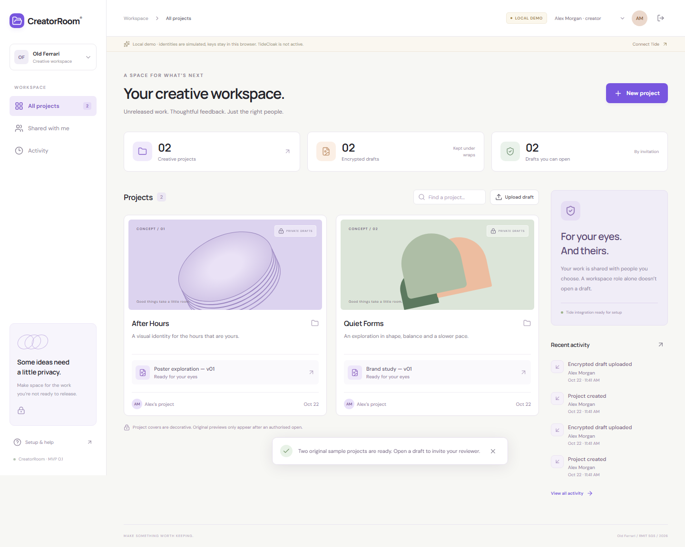

# Project overview

**CreatorRoom** is a workspace for sharing unreleased creative drafts with selected reviewers while keeping original files and feedback encrypted before upload.

**Vision & originality.** A small creative team can create projects, invite a fresh pair of eyes to one draft, and discuss it in a focused review room. Decorative project covers let the workspace feel visual without publishing protected previews.

**Trust constraint.** Ordinary collaboration services can become universal readers of unreleased work. CreatorRoom separates project coordination from decryption: the application stores ciphertext, and the intended Tide deployment authorises each recipient for each draft.

**Value & impact.** A student designer can ask an external reviewer for feedback on a poster without opening another project's work. Review comments are encrypted too, since feedback can reveal as much as the draft itself.

**Why TideCloak matters.** The implemented Tide adapter uses real SDK authentication, server-side JWT verification, and signed `RelationshipAttestation:1` policies bound to a recipient's Tide key and an asset ID. The prototype creator also acts as the Tide realm admin who approves policies in the browser. This path still requires enrollment, a compatible network, and live acceptance testing.

**Prototype & storytelling.** The local demo runs end to end: upload, invite, review, reject another asset, and inspect ciphertext as an operator. Its identities and browser-local keys are explicitly simulated, not Tide protection. API checks and browser tests pass; a live Tide encryption round has not yet been verified.

## Run the local demo

Requires **Node.js 22.12+**. No Docker or Tide account is needed for this development mode.

```bash
git clone https://github.com/nhbl-ai/creatorroom-old-ferrari.git
cd creatorroom-old-ferrari
npm ci
npm run demo
```

Open **http://localhost:3000** in one browser/profile:

1. Enter as **Alex Morgan · creator** and click **Load sample workspace**.
2. Open **Poster exploration — v01**, select **People & access**, and invite **Jamie Chen**.
3. Close the room. Use **Demo identity** in the top bar to switch to Jamie.
4. Open the invited draft and leave feedback. Try **Brand study — v01**: access is denied.
5. Switch to **Platform operator** to inspect ciphertext. Its direct draft-opening API is denied too.

You can also create projects and upload PNG, JPEG, WebP or TXT files up to 1 MB.



### What local demo mode means

Demo sessions are simulated. WebCrypto AES-GCM keys are held in browser IndexedDB, shared by all demo personas in that browser. Server records contain ciphertext, but this harness is **not a security boundary between demo users**. Use synthetic work only. A different browser has no copy of these demo keys. The demo server binds loopback and cannot run with `--production`.

## Connect real TideCloak

Follow **[the step-by-step Vietnamese setup guide](docs/TIDECLOAK.md)**. It includes Docker Compose, realm enrollment, the three accounts, client configuration and the live acceptance checks.

After placing the public adapter in ignored `data/tidecloak.json` and configuring `.env`:

```bash
npm run dev
```

Without an adapter, this command shows setup instructions and fails closed for protected APIs. It does not silently use demo identities.

```bash
npm run build
npm start
```

The production command requires real Tide configuration. This is a hackathon prototype: complete the live tests and review deployment requirements before hosting it for real users.

## Validation

```bash
npm test
npm run build
```

Browser tests use a dedicated port and separate test data. Install Chromium once:

```bash
# macOS / Linux
PLAYWRIGHT_BROWSERS_PATH=.cache/ms-playwright npx playwright install chromium
npm run test:e2e
```

```powershell
# Windows PowerShell
$env:PLAYWRIGHT_BROWSERS_PATH = Join-Path (Get-Location) '.cache/ms-playwright'
npx playwright install chromium
npm run test:e2e
```

See **[validation results and limits](docs/VALIDATION.md)**. Passing local tests does not prove a live Tide network integration.

## Architecture and team handoff

| Area | Files |
|---|---|
| React review workspace | `src/App.jsx`, `src/styles.css` |
| Browser encryption and Tide policy signing | `src/lib/crypto.js`, `src/lib/tide.js` |
| Express API and per-asset invitations | `server/app.js` |
| Demo sessions and real JWT verification | `server/auth.js` |
| Atomic single-process JSON store | `server/store.js` |
| SDK policy parser bundled for Node | `server/tide-policy-runtime.js`, `scripts/build-policy-runtime.mjs` |
| API and browser checks | `tests/` |

Runtime files are under ignored `data/`; generated bundles, browsers and test state are under ignored `.cache/`. Do not run multiple app processes against the same JSON store. Project names, asset metadata and audit metadata are visible to signed-in workspace users; original file contents and feedback are encrypted. Audit records are ordinary app logs, not a tamper-proof ledger.

Read [CONTRIBUTING.md](CONTRIBUTING.md), [the current MVP scope](docs/MVP.md), and [workstreams for teammates](docs/TEAM.md). Removing an invitation stops subsequent API access; a saved Tide policy can work until expiry and already-read plaintext cannot be recalled. Tide mode requires DPoP proof verification. A separate admin/quorum workflow is not implemented.

## Team and submission

**HCMUS - Old Ferrari — RMIT SGS**, RMIT Hackathon 2026, Challenge 2. Submission team name (preserved from the team's README): `RMIT_SGS_HCMUS - Old Ferrari_C2`.

- [x] Public source repository and a runnable local prototype.
- [ ] Configure TideCloak and verify the real sign/encrypt/share/decrypt/refuse flow.
- [ ] Record the two-minute `.mp4` under 100 MB inside `demo/`.
- [ ] Update the overview with verified final behaviour, keeping it at 300 words or fewer.
- [ ] Submit the repo URL through the [official form](https://forms.gle/HRHYjnqB86j1LFS97).

Recorded Vietnam deadline: **22 October 2026, 18:00 (UTC+7)**. Publishing this repository alone does not submit the entry.

[Challenge brief](https://tide.org/unlocked/) · [TideCloak docs](https://docs.tide.org/) · [Third-party notices](THIRD_PARTY_NOTICES.md)
